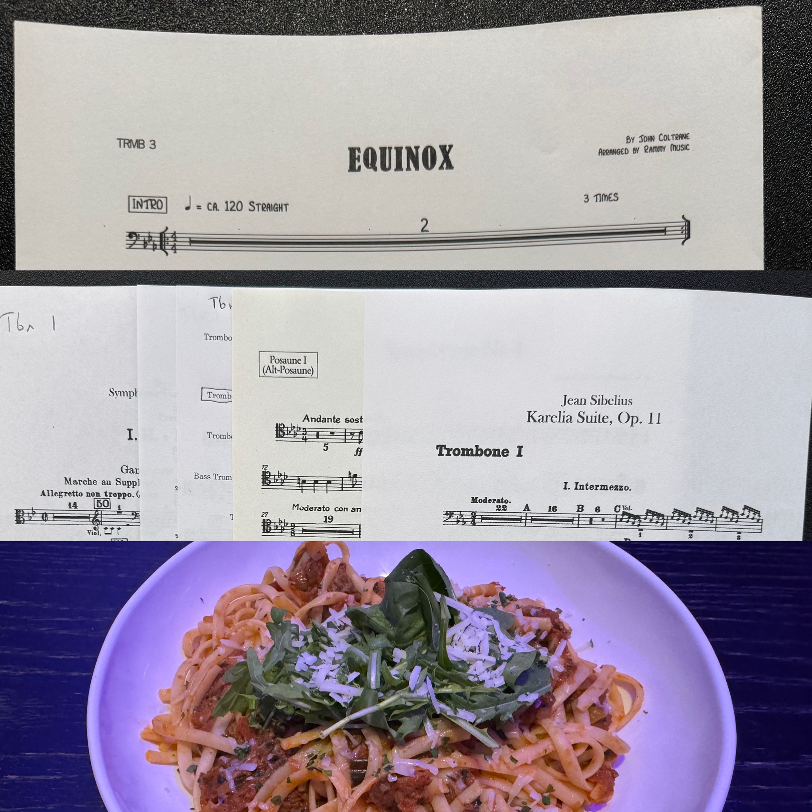

# More Recordings, Wind Ensemble, and Handsome Guys

**TL;DR:**
- I finished the last batch of my audition recordings
- Rehearsals began for next week's wind ensemble concert
- I'm a handsome guy!

## Life Update

### Music Things

In my third recording session for an external audition, I got three takes that I liked, with one being almost ideal with the exception of one incorrect note. Strangely, my number of usable takes from the fourth session dropped back down to two, even though I thought I was in better condition compared to the previous session. It seems that the law of diminishing returns and general exhaustion of recording so many takes is starting to get to me, as I only got one usable take during my final recording session. In the end, I settled on using the last take I recorded during the fourth session for my final submission, as it was sounded the most musical while having the least glaring flaws. After focusing this much on audition material for the last few weeks, I'm more than a bit relieved that I can finally turn my attention elsewhere, and patiently wait for results.

I had one of my busiest days since coming to the RNCM this week, where I basically did nothing but play the trombone. In the morning, I had a brass orchestral excerpt session with other students, which featured quite a lot of standard snippets I was already familiar with, though the notable exception was the intermezzo from Sibelius' Karelia Suite. Right after lunch was my first rehearsal for next week's wind ensemble concert, and not even preparing the repertoire beforehand could save me from how challenging it was in an actual rehearsal environment. To make matters worse (or better, depending on how you look at it), I was only playing in around half of the programme due to instrumentation requirements, and the other half was just as difficult if not more so. Thankfully, practically all of my time next week will be occupied with polishing up this repertoire. I capped off this day (once I had a tasty beef ragu linguine at the RNCM's cafe) by rehearsing in the evening with the Lancashire Sinfonia for their concert in a couple of days. If it wasn't for everything coming up, I would be glad to have a (short) break from playing the trombone once all this was over.

The wind ensemble's subsequent brass sectional was mainly dedicated to fixing our weak spots, of which there were many. While we made a lot of progress, and will likely have everything sorted ahead of our guests' arrival next week, us trombones decided to have at least one more mini-sectional to go through our roughest parts. I also learned that I would be bumping (playing notes that would be awkward for a single player) in one more piece, so I'll be having a bit more fun, assuming my copy of the part gets to me in a timely manner.

The focus of this week's private lesson was improving my articulation, mainly by reducing the overall weight of my tonguing. To that end, I enlisted the help of a modified set of exercises from the Arban book, which I'll almost certainly incorporate into my daily routine, since it does have the side effect of improving my tone colour as well.

While studio class was another one with piano accompaniment, I came into it far less prepared than I intended for too many reasons, the vast majority of them being my own failings. As a result, I performed below my own expectations and received feedback along those lines, particularly on my recurring issues when playing. Still, I did learn some methods to fix them, along with gaining insight into the differences between British and (North) American trombone pedagogy.

The second and last Off-Beat Lab session for this project/cycle mainly focused on recording our set-list, which was done with a rather professional setup, complete with a whole host of mics and a physical workstation. The trombones were also provided with modified parts, since the previous one had a rather cumbersome D.S. al coda section (remember, the RNCM uses paper copies for everything), though I ultimately settled on using my shorthand-annotated original copy due to the new version being even more bulky to flip. Since everything went as expected, the session finished ahead of schedule, though it'll be some time before the recordings are edited and sent out. Still, this left some time for our instructor to tell us an extremely funny story about a famous British trombonist that once studied at the RNCM (though not someone I heard of before), which I'll share here for some useful motivation.

During that trombonist's undergrad, he was incredibly shy. His trombone teacher's solution? Tell him to take off his shirt in the middle of their lesson, look in the mirror, and yell "I'm a handsome guy!" (Note: This was at least 30 years ago. They could get away with stuff like that at music schools back then). With the trombonist being unwilling to do something so outrageous, his teacher did it first, giving the student enough motivation to do it himself. Lo and behold, shouting affirmations at the mirror while shirtless was what both teacher and student did for the rest of their lesson, and this proved to be so much of a confidence booster that this essentially kickstarted the trombonist's career.

So next time you need to believe in yourself, look in the mirror (shirt optional) and yell "I'm a handsome guy!" (or your descriptor of choice). Who knows, perhaps that'll lead to you being an internationally-renowned trombonist one day.

### Music-Related Things

In a bit of good news, I made the RNCM's University Challenge team! For those of you who don't know, University Challenge is a TV quiz show where teams from British universities compete against each other, and is a rather popular series. I got onto the team by being one of the highest scorers on a trivia test organised by the RNCM's student union, though this is only the first step to actually appearing on TV, so I'll give out further updates about this whenever possible!

## Music Review

Remember when I mentioned that the Concert Review section would be getting a major rework last week? Well, I'm happy to announce it's because I've joined the team of reviewers over at Classical Source, and will be posting the bulk of my reviews there from now on. You can check out my first review <a href="https://www.classicalsource.com/cd/a-hip-old-world-eroica-from-minasi-ensemble-resonanz/"> over there</a> on chamber orchestra Ensemble Resonanz and conductor Riccardo Minasi's recording of Beethoven's *Eroica Symphony*.
