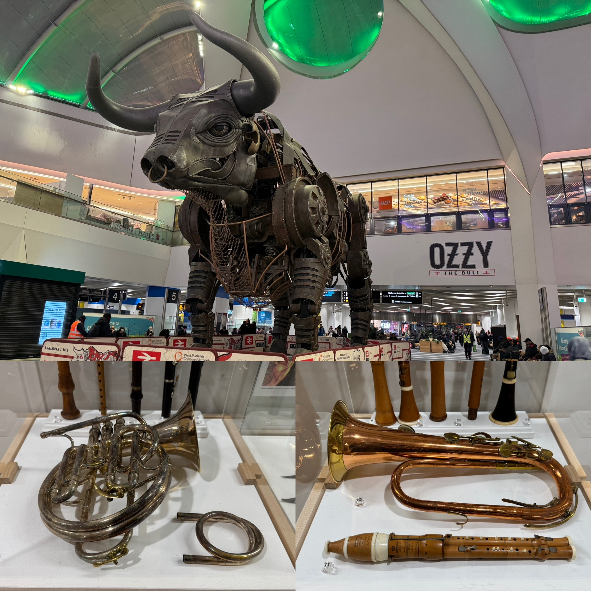

# Audition Challenges, Children's Opera, and The Odyssey Reviewed

**TL;DR:**
- My luck in auditions wasn't that good
- Robin Hood likes kids (no, not in that way)
- My review of Christopher Nolan's The Odyssey is finally here

## Life Update

### Music Things

While I mainly focused on polishing up more audition repertoire in my first lesson of the week, this was in preparation for other external programmes I have an interest in joining, rather than the RNCM orchestral audition later this week. Despite having played most of these pieces and excerpts for other auditions before, it was clear that there were still plenty of things I could work on, especially in my weakest excerpts. Still, my increase in experience since then means I have more insight into my deficiencies and the tools needed to fix them effectively, so I'm confident that they'll sound better than before with added effort.

As mentioned above, I had a RNCM audition for the symphony orchestra's performance of Prokofiev's Fifth Symphony next term. Overall, I'd say this audition went at least as well as the Shostakovich one, if not better than it, mainly because my playing did improve over the past month and I was better-prepared. The one exception was a minor error the second-to-last excerpt, though it wasn't as bad as cracking the highest note repeatedly in the Shostakovich audition, or my various stylistic failures in the BBC Philharmonic and Hallé PES auditions. Unfortunately, I didn't make the cut again, but while it means my chances of participating in a public-facing RNCM symphony orchestra this year have dropped significantly (repertoire orchestra doesn't count), I suspect this was a closer call than the Shostakovich audition. Only time and my own effort will tell where I progress from here.

I also began recording material for one of the external auditions I'm doing, though I didn't get a take I liked during my first session, mainly due to not being in the best condition to play. Rather than infuriate myself further with each botched take, I instead pivoted the remainder of my session into honing everything else, so that later sessions would be more productive. Unfortunately, I was dissatisfied with my takes during the second recording session for similar reasons, especially since I only got a couple I'd consider workable, and they aren't up to my standards. I've still got a few more days until I need to submit this material, so I've got enough time to improve and produce something I actually want to send out.

Since my trombone quartet at the RNCM was at an impasse about our choice of repertoire in the short-term, I suggested Steven Verhelst's Trombone Quartet No. 2 to tide us over for now, especially since I played it before. While we aim to eventually work on more elaborate pieces, I believe the straightforward first movement of Quartet No. 2 will help us work on our ensemble skills in time for our coaching session later in the month, alongside a movement from Gordon Jacob's Suite for Trombone Quartet. That said, I last seriously touched this piece during my third year at UBC, to say nothing of everyone else having never played it before, so we took it under tempo to get a feel of things. While there are definite areas for improvement, particularly with its runs and making sure everyone stays together, our reading session went rather well. Personally, I'm happy to be able to share this wonderful piece with my new colleagues, so I'm definitely not complaining.

Perhaps the most unique thing I did this week was head to a local primary (or elementary for Canadian readers) school to help with the RNCM Children's Opera. In short, this is an annual event involving several classes of primary school children from schools around Manchester coming together to create an opera (read: musical) with a local composer, with each school being in charge of one act, and RNCM students either acting alongside them or providing music in a fully staged performance later in the academic year. Of course, every RNCM student knows the real reason for lending their time and expertise to bring music into schools for this worthwhile cause is the free breakfast and lunch we get, but I digress.

While leading small groups of children during the brainstorming process was certainly fun, especially with how imaginative and enthusiastic they were throughout, my highlight of the day was seeing how the composer eventually meshed all their ideas together into a coherent piece of music. Since this year's theme is Robin Hood, and the school I went to was in charge of the opera's first act, the kids thought up a song about going to meet him. With some guidance and harmonic support from the composer, the children chose the direction of the melody and the chorus, but most of the verses' lyrics required some fine-tuning after their brainstormed drafts were collected. After all, singing that "[Robin Hood] likes kids" (yes, that was an actual scrapped line) in front of an audience of parents is definitely going to raise more than a few eyebrows.

Even so, the resulting song turned out to be remarkably catchy in the end, and the kids were extremely eager when singing their own composition, which was combined with some choreography. With this only being the first session of three before the performance itself, I can definitely se why this programme has been such a hit with the community for over a decade, and really enjoyed being a part of it so far. Unfortunately, the next session won't happen for a couple of months, so no free food until then. :(

## Cinematheque

I’ll get this out of the way first: **The Odyssey** isn’t my favourite Christopher Nolan film (that honour goes to Interstellar). However, with how it interprets its source material of Homer’s millennia-old epic, along with the discussion said interpretation has generated, I’m more than willing to make the claim that The Odyssey is Nolan’s most culturally-relevant film since the Dark Knight trilogy.

Since its original mythology has already been well-trod through a large number of adaptations, the summary I’ll provide of its plot here will just be to outline key details that’ll be relevant to my later points. Following the end of the Trojan War, its hero Odysseus (played by Matt Damon) seeks to return home to Ithaca with his surviving subordinates after 20 years, encountering various tribulations along the way. Meanwhile, his wife Penelope (played by Anne Hathaway) fends off potential suitors for her hand in marriage and Ithaca’s throne with the help of her son Telemachus (played by Tom Holland).

Despite the criticisms of its faded and unsaturated colour palette (which I wholeheartedly agree with), The Odyssey compensates for this ‘realism’ through its practical visual effects, which give the entire movie a truly epic and grandiose feeling. In particular, the monsters Polyphemus (the cyclops) and Scylla look genuinely unsettling, almost as if they didn’t belong in this world in spite of their realistic textures. With fewer filmmakers turning to practical effects and CGI studios unable to deliver high-quality results due to chronically being overworked, achieving this level of uncanniness is something that I feel is getting harder and harder to do these days.

However, aside from being directed by Christopher Nolan, what garnered The Odyssey the most attention in today’s media-saturated day and age is the cultural discourse it generated. The clearest example of this is through some of its casting choices, namely Lupita Nyong’o as Helen of Troy and Elliot Page as Sinon. With their appearances going against ‘conventional’ depictions of their characters (Nyong’o’s Helen of Troy and Page’s Sinon), Nyong’o and Page certainly had no shortage of trouble in getting audiences to accept their depictions. However, I’d argue this works in their characters’ favour, and even enhances the narrative.

Since Helen of Troy was the beauty that sparked the Trojan War (or in Nolan’s interpretation, merely used as an excuse by Agamemnon to seize control over trade routes), and was eventually scarred after it ended to prevent anyone else from laying their hands on her, Nyong'o's casting adds an extra layer to Helen of Troy's character. Just as Telemachus was forced to confront the desecrated face of Troy when he first laid eyes on Helen, audiences were similarly made to evaluate their own idea of beauty, raising the question of what it truly means in this day and age.
forcing audiences to confront the ideal of beauty just as much as Telemachus did when he first laid eyes on her.

While Sinon was sent to the frontline as the result of deception, and started Odysseus' campaign as a reluctant warrior, his development into a loyal soldier ultimately culminated in his sacrifice to keep the Trojan Horse ruse intact. With such a display of devotion often reserved for the manliest of men, one would expect Sinon to have an appearance that reflects modern society's ideal of masculinity, such as a beard or ripped muscles. Instead, Page has none of these traits, which does make him look out of place compared to his more well-built co-stars. This distinction conversely fits his role in the narrative of someone who wasn't meant to be on the front lines, yet performed his duty to the bitter end nonetheless, perfectly encapsulating how true heroes can emerge from the unlikeliest of bodies or minds.

Ultimately, my thoughts on The Odyssey can be summed up by this quote from The Economist's own review: "Every adaptation of an ancient text is as much about its own era as the original work; less a lens than a mirror". While this can definitely be seen in the responses to Nyong'o and Page's casting, I personally think that The Odyssey's cultural commentary is most relevant when it frames Odysseus' journey home as the last hurrah of the legendary Bronze Age. With The Odyssey originating from oral tales about the Trojan War passed down after the Bronze Age collapse, a series of calamities that resulted in societal annihilation across the Mediterranean, Nolan's choice to make this destruction and rebirth of civilization part of his film's overarching themes themes feels rather profound. Even though he couldn't have predicted the state of the world during his film's production and release, noticing the writing on the wall was definitely possible for Nolan, what with the world's 'old order' seemingly fading away over the past several years. In a way, despite his version of the Odyssey hiding some rather bleak subtext about the direction our modern world is heading in, Nolan still offers a simple solution to the problems we face with his interpretation of Zeus' law (inaccurate and Christianized as it may be):

"Do unto others as you would have them do unto you."
