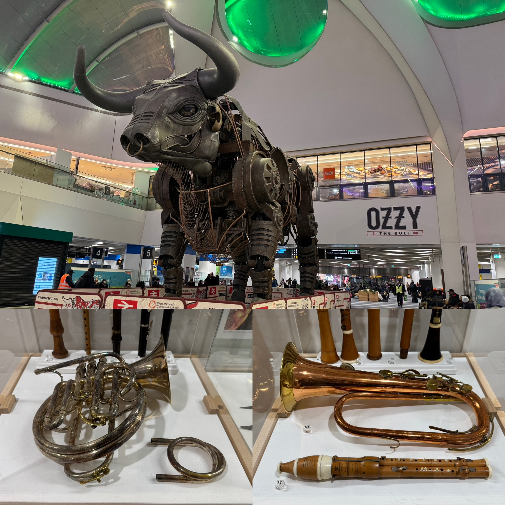

# Title

**TL;DR:**
- Robin Hood likes kids (not in that way)

## Life Update

### Music Things

While I mainly focused on polishing up more audition repertoire in my first lesson of the week, this was in preparation for other external programmes I have an interest in joining, rather than the RNCM orchestral audition later this week. Despite having played most of these pieces and excerpts for other auditions before, it was clear that there were still plenty of things I could work on, especially in my weakest excerpts. Still, my increase in experience since then means I have more insight into my deficiencies and the tools needed to fix them effectively, so I'm confident that they'll sound better than before with added effort.

As mentioned above, I had a RNCM audition for the symphony orchestra's performance of Prokofiev's Fifth Symphony next term. Overall, I'd say this audition went at least as well as the Shostakovich one, if not better than it, mainly because my playing did improve over the past month and I was better-prepared. The one exception was a minor error the second-to-last excerpt, though it wasn't as bad as cracking the highest note repeatedly in the Shostakovich audition, or my various stylistic failures in the BBC Philharmonic and Hallé PES auditions. Unfortunately, I didn't make the cut again, but while it means my chances of participating in a public-facing RNCM symphony orchestra this year have dropped significantly (repertoire orchestra doesn't count), I suspect this was a closer call than the Shostakovich audition. Only time and my own effort will tell where I progress from here.

I also began recording material for an external audition, though I didn't get a take I liked on my first day of doing so, mainly due to not being in the best condition to play. Instead, rather than infuriate myself further with each botched take, I pivoted the remainder of my session into honing everything else, so that later sessions would be more productive.

Since my trombone quartet at the RNCM was at an impasse about our choice of repertoire in the short-term, I suggested Steven Verhelst's Trombone Quartet No. 2 to tide us over for now, especially since I played it before. While we aim to eventually work on more elaborate pieces, I believe the straightforward first movement of Quartet No. 2 will help us work on our ensemble skills in time for our coaching session later in the month, alongside a movement from Gordon Jacob's Suite for Trombone Quartet. That said, I last seriously touched this piece during my third year at UBC, to say nothing of everyone else having never played it before, so we took it under tempo to get a feel of things. While there are definite areas for improvement, particularly with its runs and making sure everyone stays together, our reading session went rather well. Personally, I'm happy to be able to share this wonderful piece with my new colleagues, so I'm definitely not complaining.

Perhaps the most unique thing I did this week was head to a local primary (or elementary for Canadian readers) school to help with the RNCM Children's Opera. In short, this is an annual event involving several classes of primary school children from schools around Manchester coming together to create an opera (read: musical) with a local composer, with each school being in charge of one act, and RNCM students either acting alongside them or providing music in a fully staged performance later in the academic year. Of course, every RNCM student knows the real reason for lending their time and expertise to bring music into schools for this worthwhile cause is the free breakfast and lunch we get, but I digress.

While leading small groups of children during the brainstorming process was certainly fun, especially with how imaginative and enthusiastic they were throughout, my highlight of the day was seeing how the composer eventually meshed all their ideas together into a coherent piece of music. Since this year's theme is Robin Hood, and the school I went to was in charge of the opera's first act, the kids thought up a song about going to meet him. With some guidance and harmonic support from the composer, the children chose the direction of the melody and the chorus, but most of the verses' lyrics required some fine-tuning after their brainstormed drafts were collected. After all, singing that "[Robin Hood] likes kids" (yes, that was an actual scrapped line) in front of an audience of parents is definitely going to raise more than a few eyebrows.

Even so, the resulting song turned out to be remarkably catchy in the end, and the kids were extremely eager when singing their own composition, which was combined with some choreography. With this only being the first session of three before the performance itself, I can definitely se why this programme has been such a hit with the community for over a decade, and really enjoyed being a part of it so far. Unfortunately, the next session won't happen for a couple of months, so no free food until then. :(
