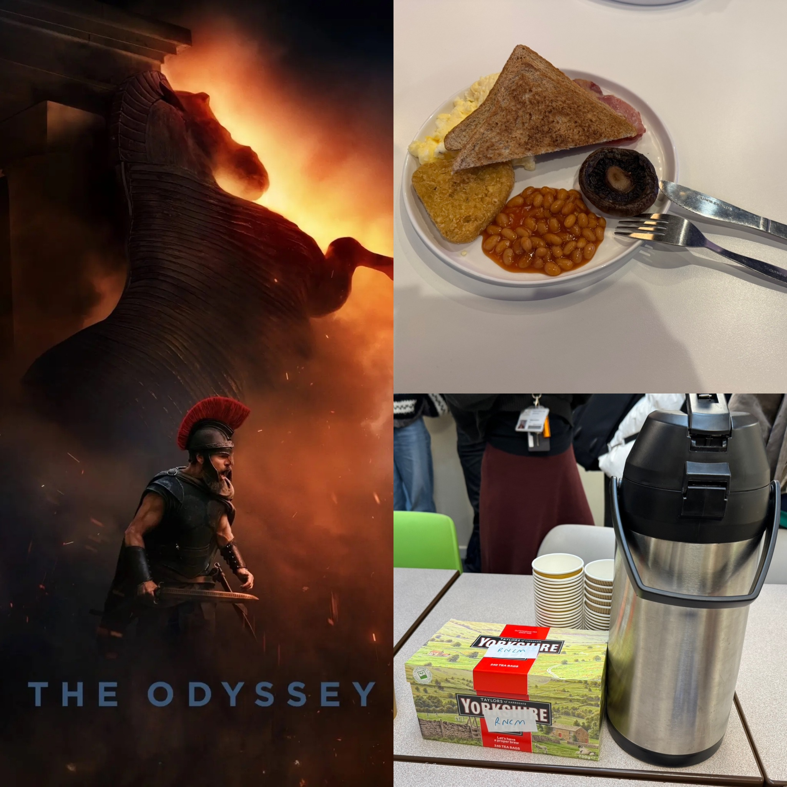

# Reading Week, Y, and Z

**TL;DR:**
- 

## Life Update

### Music Things

Despite it being reading week at the RNCM, I still had a trombone lesson due to scheduling quirks. However, it seemed like the universe (or at least whatever higher force is governing the RNCM) *really* didn't want me doing anything at school during this week, as there was a fire alarm right when I was getting into my lesson. Thankfully, there wasn't an actual fire, but I lost half of my lesson time as a result, and the remaining thirty minutes were barely enough to cover a single piece from my audition material. At least I'll be having an additional make-up lesson sometime in the future.

The third session of recordings I did for an external programme's audition proved to be the most productive so far, as I got two takes I felt satisfied with out of it. However, I probably won't be using either of them, since I thought the overall quality of my takes increased during the fourth and final recording session, so my submission will likely be chosen from one of the two takes I liked. Strangely enough, I was originally going to select only a single take from the fourth session for my consideration, but I discovered that another take was surprisingly of comparable quality after listening to it instead of my original chosen take by accident. I'll definitely be thankful I don't immediately delete my 'unsatisfactory' takes after I finish playing them back.

After listening to all four of my chosen takes a few more times, I ultimately decided to submit the take I didn't plan on choosing from the fourth recording session, since I thought it showed my highest level of musicality while being mostly consistent throughout. Now that I've submitted my audition application, I won't have to think about this programme anymore until mid-December, though I've still got another application video due in a couple weeks' time. Having learned a few things the hard way, I'll definitely work a lot smarter when recording the next round of videos, which includes employing some tips I picked up for my preparation process to ensure a better-quality final product.

Since I didn't go to the last Lancashire Sinfonia rehearsal (the external gig I mentioned in a previous post) due to no trombones being required, this week's rehearsal was the first I went to in a month. While I was previously informed we were rehearsing Dvorak's A Hero's Song this time, it wrapping up ahead of schedule meant we had time to play Tchaikovsky's Nutcracker Suite as well, which wasn't what I planned for or had rehearsed with the orchestra before. Even so, it was a joy playing a familiar piece once more.

### Non-Music Things

After only visiting it in a hurry a little over a month ago, I finally got the chance to tour the John Rylands Library in greater depth during reading week, including some of its artefacts on display. Aside from seeing fragments of one of the oldest surviving book copies of the Odyssey (Homer's text, not Christopher Nolan's film) from 3rd-century CE Egypt up-close and learning about Charlemagne's (the first Holy Roman Emperor) impact on Europe from thousand-year old handwritten books written during his reign, I thought that I was lucky enough to view copies of the Gutenberg Bible (the first printed book in the Western world) in person. Unfortunately, they were just facsimilies, but the staff member I chatted with told me that the originals were in similarly good condition, despite being around 600 years old.

Another place I visited during reading break was the People's History Museum, which was about the centuries-long struggle for rights and suffrage in the UK. While I already knew some of this history, seeing the museum connect such disparate facets of life such as industrialization, empire, and war together into a coherent narrative about the fight for a better life was nothing short of enlightening, and definitely reminded me that quite a lot of things we take for granted today were the result of other people's sacrifices. Even with 'History' being in its name, the museum doesn't shy away from more modern topics, including a display/testimony about a topic of particular significance to me. However, perhaps the most interesting object on display was a jacket worn by then-Mayor of Greater Manchester (and now Prime Minister) Andy Burnham during a pivotal 2020 COVID speech, which some people say was the first step that lead to him being in a position to take up the premiership. This goes to show that even if we don't notice it, history is constantly happening before our very eyes.

(On a more humourous note, I spotted two trombones at the People's History museum: a drawn one in a political cartoon about the Duke of Wellington, and a real one from a union workers' brass band.)
