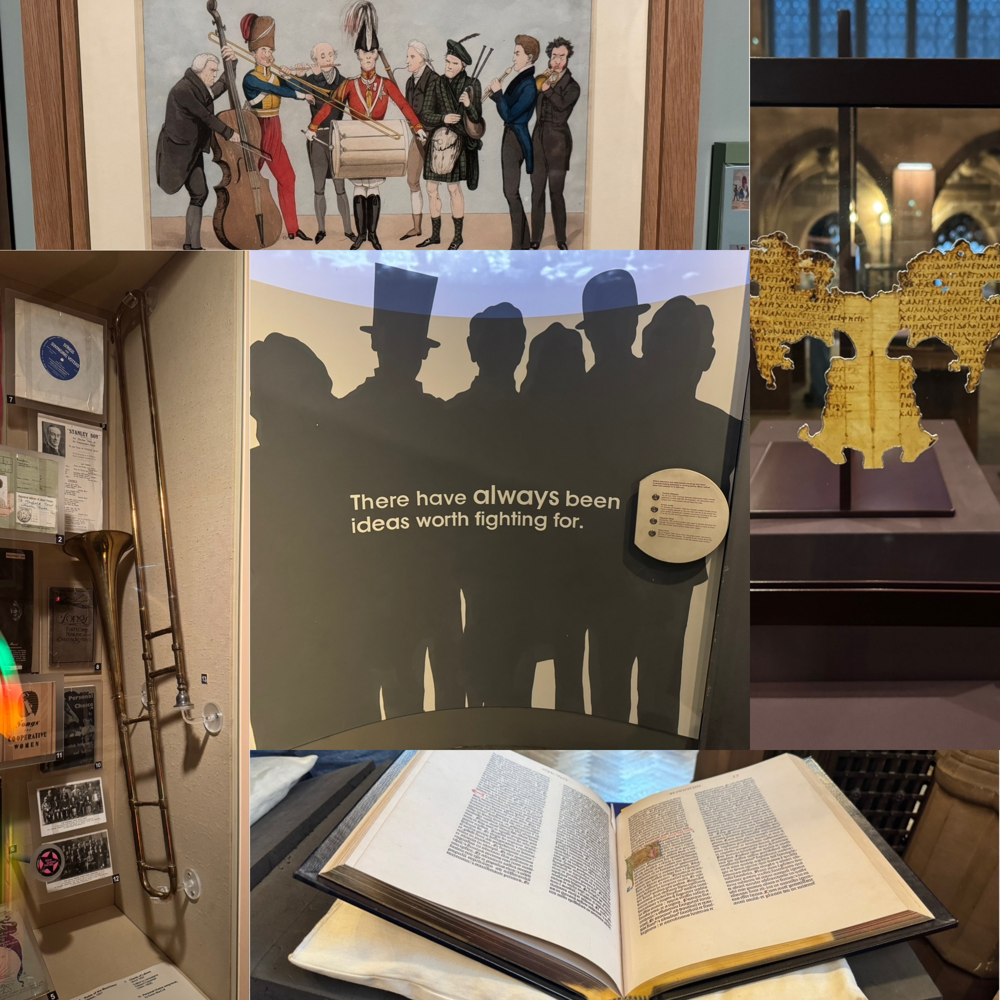

# TITLE

**TL;DR:**
- 

## Life Update

### Music Things

I had my first meeting with a supervisor for one of my courses, where I outlined my ideas for the topic of my final project. This shouldn't come as a surprise to anyone who knows my taste in trombone repertoire, but I ultimately settled on exploring the solo music of Arthur Pryor and his early 20th-century contemporaries, an area which I already have some knowledge. Aside from giving me the go-ahead, my supervisor also pointed me towards some useful resources for my research, including Trevor Herbert's extremely comprehensive history book 'The Trombone'. While it's available at the RNCM's library, there's so much useful information in there that I'm thinking of getting my own copy in the future.

This week also marked my first Off-Beat Lab rehearsal. To sum up its purpose, the Off-Beat Lab is basically the jazz band version of the Repertoire Orchestra, but with a faculty member as bandleader and the final product being a recording instead of an informal performance. Aside from rehearsing our assigned pieces as written, the ensemble was given opportunities to try improvising over the rhythm section during solo sections, before choosing the soloists for the final recording. Since I haven't improvised properly for quite a long time (outside of playing blues arpeggios onstage with Al Kay after drinking hot sauce, but that's a story for another time), I ultimately wasn't chosen as a soloist, which honestly came as a relief.

Thankfully, the faculty member in charge of the rehearsal offered all of us some invaluable advice for getting better at improvising, which boiled down to practicing scales more deliberately, and I have to agree. With chord knowledge being such a fundamental part of jazz compared to classical music (to the point where everyone was writing chord progressions into their parts during rehearsal), knowing how to use the notes of a given scale as a toolbox for improvisation is a must when soloing, and will certainly be a skill I'll be honing during my own practice sessions.

Since I wasn't making progress as quickly as I hoped, I'd consider my lesson this week mostly a wash on my end, especially since I am concentrating on practicing audition material rather than the fundamentals that could improve my overall technique. Still, I did receive useful stylistic advice for interpreting said audition material, so I've got a better idea on how to execute it during my recordings.

Conversely, trombone quartet practice went rather well this week, possibly because we had a two-hour session this time around instead of our previous one-hour sessions, which allowed us to cover and refine more material. Since we ultimately decided to play the Jacob Suite for Trombone Quartet for our coaching later this week, with it covering a lot of ensemble fundamentals, we spent our entire rehearsal polishing it and fixing our weak points.

### Music-Related Things

After almost a month of wrangling, I finally now have a locker that fits both my trombone and my rental sackbut, along with any other equipment I need. Is this the place to say how much I miss the vastly simpler UBC system?

### Non-Music Things

Following up on my previous museum visits last week, I finally went to the Manchester Museum at the University of Manchester after passing by it during my first day in town. Ironically enough, this museum doesn't have much to do with Manchester itself (aside from some displaying archaeological finds in the city and surrounding areas), but is more of a (natural) history museum, with exhibits on different cultures, past and present life, and ancient history.

One of the more interesting things I thought the Manchester Museum did was in its Africa gallery, where the vast majority of information on its displayed items was marked as unknown, including their traditional names and uses. A plaque in front of the gallery stated that this was because most of these items were acquired through dubious means, up to and including theft, with spotty record-keeping due to how they made their way to the UK. It then concluded with a request for anyone with information about these items to get in touch with the museum, though I'd consider (from my perspective as an outsider) that working with African institutions would be a more effective way of getting them properly catalogued.

On a lighter note, I also got to see the museum's two most interesting (and weirdly anti-climactic) exhibits. The first was Stan the T-rex fossil, who the museum proudly emblazons on quite a lot of merchandise as an unofficial mascot. Except that the Manchester Museum doesn't have the actual Stan Fossil - it's in Abu Dhabi, with the museum having a replica! Still, as long as this white lie gets kids through museum doors and actually legitimate exhibits, then I'm happy to turn a blind eye.

The second exhibit was a 'cursed' statuette in the Ancient Egypt gallery, which could slowly spin on its own without any apparent outside force (there's even a timelapse of it doing so out there). Despite rumours of a pharaoh's curse that boosted museum attendance numbers, a university professor concluded that people walking past the statuette produced tiny vibrations that were felt by the glass it was on, and the statuette being naturally unbalanced was what caused it to spin. This was ultimately solved by sticking the statuette to the glass, ending any talk of so-called curses right then or there. Or maybe the statuette's slowly building up its power to spin the entire museum around instead...

## Practice Room

In my recent practice sessions, I've been playing my upcoming video audition material for three times in a row to build endurance and consistency. Since I will almost certainly be recording many takes over several sessions before finding one that I like, endurance is key to recording as much as possible in a given session, and was one of the problems I faced during my last video audition. Becoming more consistent will also help with preventing later takes in a session from having a 'weaker' sound than earlier ones, despite them often being better technique-wise.

While this technique was originally meant for recital preparation, and requires more time to fully take effect than just a couple of weeks, it's already been rather useful despite me using it in a modified capacity for just a few days. Combined with changing up how I execute certain passages for better musicality, I can now project a fuller sound, even after playing through all my repertoire several times. Now that I know this practicing technique works, I'll definitely be using it to prepare for other auditions and my eventual second-year recital.
